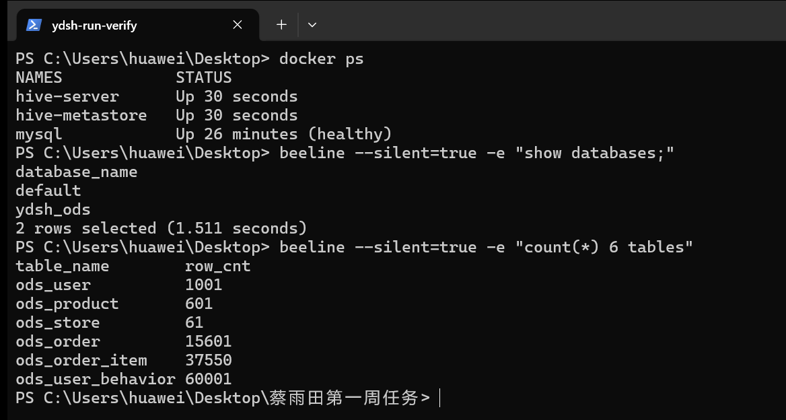

# 环境搭建笔记（第 1 周）

> 记录 Docker / Hive / MySQL 环境搭建过程中的问题、排查方法与解决方案。
> 本文件随实操逐步更新，作为团队环境排障知识库。

## 1. 环境清单
| 组件 | 版本 | 说明 |
|------|------|------|
| Windows | 11 | 部署主机（WSL2 后端） |
| WSL2 | 2.x | Docker Desktop 后端 |
| Docker Desktop | 29.x | 容器运行环境 |
| apache/hive:4.0.0 | 4.0.0 | Hive（metastore + hiveserver2） |
| mysql:8.0 | 8.0 | Hive 元数据库 |
| Git | 2.53.0 | 版本管理 |

## 2. 部署步骤
1. 安装 Docker Desktop（勾选 WSL2 后端），重启电脑。
2. 编写 `docker-compose.yml` 编排 mysql + hive-metastore + hive-server。
3. `docker compose up -d` 启动，`docker ps` 验证三容器 Up。
4. `docker exec -it hive-server beeline -u jdbc:hive2://localhost:10000` 连接 Hive。
5. 建库建表、导入数据、质量评估、清洗。

### 2.1 启动顺序说明
Hive 依赖链：**MySQL → Hive Metastore → HiveServer2**，必须按此顺序启动。
- `mysql` 必须健康（`healthcheck` 通过）后，`hive-metastore` 才会启动；
- `hive-metastore` 启动后，`hive-server` 才启动；
- 若跳过依赖直接启动 hive-server，会报 `Connection refused` 错误。

## 3. 遇到的问题与解决

### 问题1：Hive Metastore 启动失败 / 连不上 MySQL
**现象**：`docker ps` 显示 `hive-metastore` 容器反复重启，日志报 `Communications link failure` 或 `Access denied`。

**排查方法**：
```bash
docker logs hive-metastore --tail 100
```

**常见原因与解决方案**：
| 原因 | 解决方案 |
|------|----------|
| MySQL 未就绪就启动 metastore | 确保 `depends_on` 中 mysql 的 `condition: service_healthy` |
| MySQL 密码不一致 | 检查 `MYSQL_ROOT_PASSWORD` 与 `hive-site.xml` 中 `ConnectionPassword` 是否一致（均为 root） |
| 元数据库不存在 | `hive-site.xml` 中 `createDatabaseIfNotExist=true` 已配置，确认连接 URL 正确 |
| MySQL 8.0 认证插件不兼容 | compose 中 mysql 的 `command: --default-authentication-plugin=mysql_native_password` |

### 问题2：10000 端口被占用
**现象**：`docker compose up` 报错 `port is already allocated`。

**排查方法**：
```bash
netstat -ano | findstr 10000
```

**解决方案**：
- 修改 `docker-compose.yml` 中 hive-server 的端口映射，如 `"10001:10000"`；
- 或结束占用 10000 端口的进程。

### 问题3：beeline 连接 HiveServer2 失败
**现象**：`docker exec -it hive-server beeline -u jdbc:hive2://localhost:10000` 报 `Connection refused`。

**排查方法**：
```bash
docker logs hive-server --tail 50
```

**解决方案**：
- 确认 `hive-server` 容器状态为 Up；
- 确认 `hive-metastore` 已正常启动（先起 metastore 再起 server）；
- 等待 30~60 秒让 HiveServer2 完成初始化后重试；
- 若 `hive-site.xml` 中 `hive.server2.authentication` 为 `NONE`，连接时无需用户名密码。

### 问题4：CSV 导入行数与预期不符
**现象**：`select count(*)` 结果与数据字典预期行数不一致。

**排查方法**：
- 检查是否跳过表头：建表时 `TBLPROPERTIES ('skip.header.line.count'='1')`；
- 检查字段分隔符：`ROW FORMAT DELIMITED FIELDS TERMINATED BY ','`；
- 确认 CSV 文件编码为 UTF-8，无 BOM 头。

**解决方案**：
- 若行数偏多 1，通常是表头未跳过，检查 `skip.header.line.count`；
- 若行数严重偏少，检查分隔符是否正确（本项目 CSV 均为英文逗号）；
- 若字段错位，检查 CSV 中是否有含逗号的字段（需用引号包裹）。

### 问题5：Hive SQL 中文字段乱码
**现象**：查询结果中中文显示为乱码。

**解决方案**：
- `hive-site.xml` 中 MySQL 连接 URL 加 `characterEncoding=UTF-8`（已配置）；
- 确保 CSV 文件为 UTF-8 编码；
- beeline 终端设置 UTF-8：`set hive.cli.print.header=true;`

### 问题6：Git push 失败（SSH 未配置 / 无权限）
**现象**：`git push` 报 `Permission denied (publickey)` 或 `Could not read from remote repository`。

**排查与解决**：
1. 生成 SSH 密钥：
   ```bash
   ssh-keygen -t ed25519 -C "你的邮箱"
   cat ~/.ssh/id_ed25519.pub
   ```
2. 将公钥添加到 GitHub / GitLab 的 SSH Keys 中；
3. 测试连接：`ssh -T git@github.com`；
4. 确认远程地址为 SSH 格式：`git remote -v`，若为 HTTPS 则需改为 `git@github.com:xxx/xxx.git`。

### 问题7：Docker Desktop 启动报 WSL2 相关错误
**现象**：Docker Desktop 启动失败，提示 WSL2 未安装或内核版本过低。

**解决方案**：
1. 以管理员身份运行 PowerShell，执行：
   ```powershell
   wsl --install
   wsl --set-default-version 2
   ```
2. 重启电脑；
3. Docker Desktop 设置中确认 "Use the WSL 2 based engine" 已勾选。

### 问题8：docker compose 报 project name must not be empty
**现象**：在中文路径目录下执行 `docker compose up -d`，报 `project name must not be empty`，容器未创建。

**原因**：Compose 默认用当前目录名推导项目名，目录名为中文（含非 ASCII 字符）时推导结果为空，导致命令直接退出。

**解决方案**：
```bash
docker compose -p ydsh -f docker-compose.yml up -d
```
显式指定英文项目名 `ydsh` 即可正常创建网络、卷与容器。

## 4. 验证清单
- [ ] `docker --version` 与 `docker compose version` 正常输出版本号
- [ ] `docker ps` 显示 mysql、hive-metastore、hive-server 三容器均为 Up
- [ ] beeline 可连接 Hive，`show databases;` 返回 `default` 库
- [ ] `create database ydsh_ods;` 成功
- [ ] Git 全局用户配置完成，`git config --list` 可查看 user.name / user.email
- [ ] SSH 密钥已生成并添加到远程平台

## 5. 常用排查命令速查
```bash
# 查看容器状态
docker ps

# 查看容器日志（最后100行）
docker logs <容器名> --tail 100

# 进入容器
docker exec -it <容器名> bash

# 进入 Hive beeline
docker exec -it hive-server beeline -u jdbc:hive2://localhost:10000

# 重启某服务
docker compose restart <服务名>

# 停止并删除所有容器
docker compose down
```

## 6. 运行验证记录（第 1 周实测）

> 实测时间：2026-10-30　环境：Docker 29.9.2 + apache/hive:4.0.0 + mysql:8.0

### 6.1 容器状态
```bash
$ docker ps
NAMES            STATUS
hive-server      Up 30 seconds
hive-metastore   Up 30 seconds
mysql            Up 26 minutes (healthy)
```

### 6.2 beeline 连接与库列表
```bash
$ docker exec hive-server beeline -u jdbc:hive2://localhost:10000 -e "show databases;"
Connected to: Apache Hive (version 4.0.0)
Driver: Hive JDBC (version 4.0.0)
+----------------+
| database_name  |
+----------------+
| default        |
| ydsh_ods       |
+----------------+
2 rows selected (1.511 seconds)
```

### 6.3 ODS 6 表行数校验（实跑结果）
```bash
$ docker exec hive-server beeline -u jdbc:hive2://localhost:10000 --silent=true --outputformat=tsv2 \
  -e "select 'ods_user', count(*) from ydsh_ods.ods_user union all ..."
table_name	row_cnt
ods_user	1001
ods_product	601
ods_store	61
ods_order	15601
ods_order_item	37550
ods_user_behavior	60001
```

### 6.4 验证结论
- Docker 引擎 29.9.2 正常，`mysql` 容器健康检查通过（healthy）；
- Hive 4.0.0 的 `hive-metastore` 与 `hive-server` 均 Up，beeline 可正常连接；
- `ydsh_ods` 库存在，6 张表行数与《数据质量预评估表》完全一致（各表比数据字典预期多 1 行，为表头行）；
- 以上命令的真实输出即为本周环境可用性与 ODS 导入的验证依据，答辩时可直接演示。



> 附图：2026-10-30 实测终端截图（`docker ps` 三容器 Up、beeline 连接 Hive 4.0.0、6 张 ODS 表行数）。
